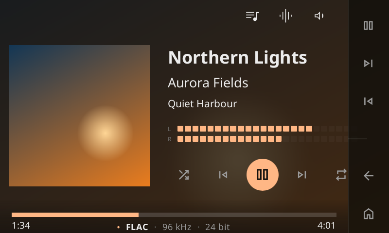
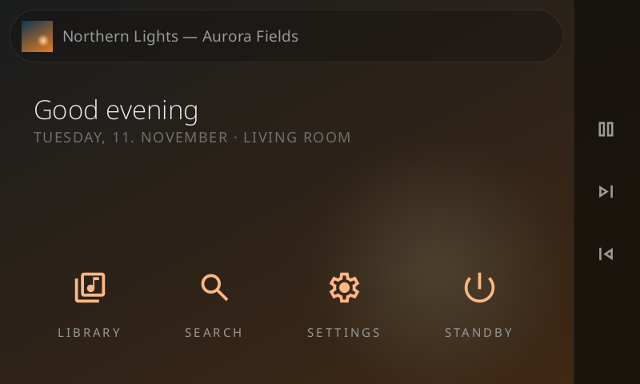
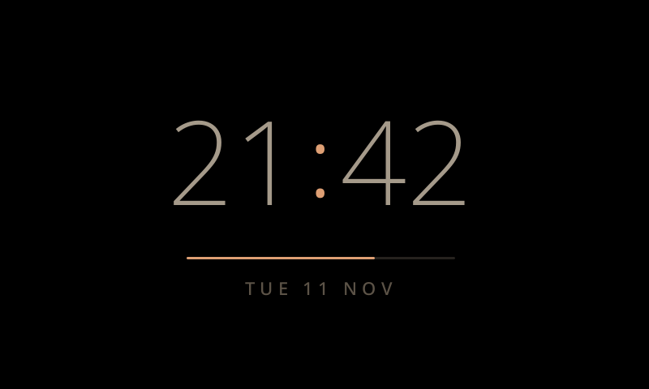

# mestro

A touchscreen now-playing display for
[Music Assistant](https://music-assistant.io/). Put a small panel
next to your hi-fi, point mestro at your Music Assistant server,
and it shows and controls whatever plays there — cover art, the
track, a VU meter, the queue and your library.

mestro is a native Rust/[Slint](https://slint.dev) app that draws
straight to the display: no browser, no desktop, boots in seconds.
It ships as a ready-to-flash image for the Raspberry Pi 4 and runs
on any Linux desktop for trying it out.

> **Status: alpha.** Daily use on one setup (Pi 4 with a 5" DSI
> panel). Expect rough edges, and please report them.

<p align="center">
  
  
  
</p>

## Features

- **Now playing** — cover art over its own blurred backdrop,
  title/artist/album, stream quality (codec, sample rate, bit
  depth), seekable progress, transport, volume. Two layouts: cover
  beside the text, or the cover edge to edge.
- **Accent from the cover** — the whole UI can take its accent
  color from the artwork, or stay in a warm amber.
- **VU meters** — analog faceplates, a spectrum analyzer, an inline
  LED meter; fed from squeezelite. Custom faceplates are a manifest
  plus SVG art ([docs/vu.md](docs/vu.md)).
- **Queue and library** — browse, search with an on-screen
  keyboard, play, add to the queue.
- **Standby** — a dim clock (digital, analog or your own face) over
  black, the cover or a slideshow of your pictures
  ([docs/standby.md](docs/standby.md)). Dims the backlight.
- **Setup from your phone** — scan the QR code on the device, sign
  in to Music Assistant, pick the player. No SSH, no config editing.
- **Remote control** — USB remotes and keyboards, `mestro ctl`, and a
  WebSocket channel on the LAN ([docs/remote.md](docs/remote.md)).
- **Robust config** — a broken setting is skipped and reported,
  never a black screen.

## Raspberry Pi kiosk image

The image boots straight into mestro (Buildroot, runs from RAM,
about 80 MB). Your settings, WiFi and pictures live on a small FAT
partition you can edit from any computer.

**Hardware:** Raspberry Pi 4 with a DSI touch panel (the official
7" display or a compatible 5"/7" panel). Audio out through
squeezelite to a USB DAC or HAT.

1. Flash the image to an SD card.
2. Open the SD card's data partition on your computer and put your
   WiFi credentials into `wpa_supplicant.conf` (or plug in a LAN
   cable).
3. Boot. The screen shows a QR code — scan it with your phone, sign
   in to Music Assistant and pick the player.

Updates install over SSH without re-flashing; building the image
yourself and adding extensions: [image/README.md](image/README.md).

## Try it on a desktop

The binary embeds the web app at compile time — build it first
(`bun` comes with the nix dev shell):

```sh
cd web && bun install && bun run build

# nix dev shell (NixOS/nix): Rust, bun and the build deps
nix develop -c cargo run -- --kiosk

# or plain cargo, when your system provides Rust and the build deps
cd .. && cargo run -- --kiosk
```

`--kiosk` opens a window the size of a 5" panel. On first start
mestro shows the setup QR code — or set the server directly:

```sh
MESTRO_MA_URL=ws://my-ma-server:8095/ws cargo run -- --kiosk
```

`--mock` shows a fake playing track without any server.

## Configuration

Most things are set on the device (Settings) or from the phone.
Everything is also a TOML file — see
[docs/configuration.md](docs/configuration.md) and the commented
[`mestro.example.toml`](mestro.example.toml).

## Contributing

Dev setup, the code layout and the Music Assistant protocol notes:
[CONTRIBUTING.md](CONTRIBUTING.md).

## License

mestro is free software under the
[GNU General Public License v3.0 or later](LICENSE).

It is built on [Slint](https://slint.dev), used under Slint's
GPLv3 option — which is what allows mestro to run on dedicated
devices like the kiosk image at no cost.
