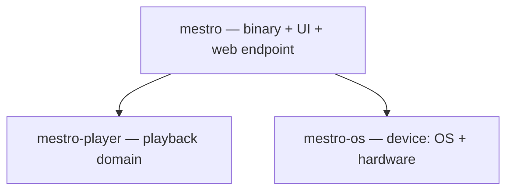

# Architecture: crates and stages

mestro grows towards a Cargo workspace: the binary and UI in
`crates/mestro`, the playback domain in `crates/mestro-player`,
everything that touches the device in `crates/mestro-os`. This
document is the target picture and the staged path there —
what exists today, what moves later, and what has to be true
before the later stages can happen.

## Why crates at all

Not structure for its own sake:

- **compiler-enforced boundaries.** `unsafe` is allowed only in
  the two audited leaf sites (the Pi firmware ioctl and the
  `kill(2)` wrapper, both in `mestro-os`); the domain crate
  `#![forbid]`s it, the binary crate denies it — slint's generated
  code carries its own local `allow`. Dependency direction is
  checked by cargo, not review: `mestro → {player, os}`, and
  neither crate ever reaches back into the app.
- **tests without Slint.** The player domain (state machine, shell,
  the source contract) is pure logic plus tokio channels; its tests
  used to drag in the whole UI build. In the workspace they compile
  and run without Slint (`cargo test -p mestro-player`). The same
  holds for the OS crate's device logic.
- **blast radius.** A backlight regression can only be in
  `mestro-os::display`; a squeezelite env-file regression only in
  `mestro-os::audio::squeezelite`.

## The crates (this state of the tree)



```
crates/
  mestro/            the binary + UI + web endpoint: app wiring,
                    config, settings, library, standby, vu (FFT,
                    skins, the meter loop), providers/ma, remote/,
                    the slint views (ui/, skins/)
  mestro-player/    the playback domain: the source contract
                    (TrackMeta, QueueItem, MediaEntry, SourceEvent,
                    PlaybackSource, SourceCaps, RepeatMode, …), the
                    state machine (player/state), the imperative
                    shell (player/shell), cover data + the
                    CoverFetcher seam (player/cover; the HTTP fetch
                    stays in the binary) and the artwork palette as
                    plain RGB (ui/palette without the slint::Color
                    conversions)
  mestro-os/         everything that talks to the device's OS or
                    hardware; nothing about MA, the UI or the web
                    protocol. One OS crate, a module per capability,
                    the fakes beside the real code:
                    - the base: atomic file writes ([atomic_file]),
                      the XDG state dir and the shared build-setting
                      helper ([paths]), device identity
                      (MAC/device id/suffix, [identity]), [lan_ip]
                      and the safe signal wrapper for kill(2)
                    - [display]: the backlight backends (Pi firmware
                      mailbox ioctl, sysfs) — the only unsafe site
                      beside the signal wrapper
                    - [wifi]: the web↔wifi contract (the ops channel,
                      the shutdown/children registry, the mDNS pause
                      gate, the [wifi] settings, the image's wpa
                      build settings) always compiled — the web
                      endpoint and the restart path name it in every
                      build; the setup lane itself (wpa_ctrl, the
                      manager, the backend, the factory reset's wifi
                      half) behind the `wifi-setup` feature
                    - [audio]: [outputs] (the renderer-neutral ALSA
                      output discovery, the picker, SwitchSlot — a
                      future in-process player reuses it),
                      [squeezelite] (the env file, derivation,
                      restart, behind `audio-output`) and
                      [visexport] (squeezelite's shm ring, always
                      built — [vu] mode = "shmem" is not gated)
                    - [timezone] (feature `timezone`): zone
                      validation, the zone list, `TZ` into mestro's
                      env file
                    - [reset] (feature `wifi-setup`): the factory
                      reset of the device state (settings overlay,
                      pairing PIN); the wifi credentials half stays
                      with the lane in `wifi::reset` — it knows the
                      wpa conf and its sidecars, the state half
                      knows the state files, and the settings op
                      calls both
```

Why one OS crate rather than one crate per device capability: a
device capability is not a domain boundary — the omicron
`illumos-utils` crate is the shape to copy (one crate, a module
per system it talks to, the fakes beside the real code), and
librespot/spotifyd keep alternative backends as features of one
crate rather than as crates. Separate crates pay off for a domain
(player), a reusable protocol (the later web/protocol/ma stages)
— not per device seam, where they only multiply manifests and
build-matrix entries for code that always moves together.

The 60 MA scenarios stay in the binary for now: they need the
private MA parser, which is a later stage. The slint-facing
throttling of backlight writes (`Display`) stays with the UI.

Feature flags are unchanged in shape: `desktop`/`linuxkms` on the
binary, and the capability features `wifi-setup`,
`audio-output` and `timezone` live on `mestro-os` — the binary
forwards each (`wifi-setup = ["mestro-os/wifi-setup"]`, …) and
its own features carry the same names. Without them mestro-os
compiles the base, the display backends, the wifi contract and
the visexport ring — exactly what the desktop build needs; the
OS crate's own test/clippy runs are `-p mestro-os --features
wifi-setup,audio-output,timezone`.

## Later stages

The end picture, in rough order — each stage keeps the tree green
and shippable:

- **mestro-web**: the embedded web endpoint (`remote/web`) minus
  the UI-bound bridge; the push pipeline becomes an event feed the
  crate owns. Prerequisite: `remote/web` stops reaching into
  `crate::Mestro` for previews — an injected renderer seam already
  exists (`PreviewRenderer`).
- **mestro-ma**: the Music Assistant client (`providers/ma`) as a
  PlaybackSource implementation, then the scenarios move out of
  the binary into that crate. Prerequisite: the private parser
  types (`parse`) settle behind the crate's public API.
- **mestro-settings**: the schema + overlay engine behind the web
  endpoint (`settings/schema.rs` today), so the web app contract
  and the Rust schema can be tested together without the UI.
- **mestro-protocol**: `remote/web/protocol.rs` + the ctl vocabulary
  (`remote/control.rs`, `remote/ipc`) — the wire surface of the
  player, shared by the kiosk, the web app and external tools.
- **mestro-testkit**: the scenario harness (fixtures, the scripted
  MA server) for out-of-tree provider tests.
- **mestro-ota**: the update lane (`remote/web/server/ota.rs`,
  the image-side scripts) once the upload path is a stable seam.
- **xtask**: the image/tooling helpers (snapshot exports, the
  golden-schema check, the aarch64 staging script) behind `cargo
  xtask`, replacing ad-hoc shell invocations.
- **plugins**: runtime VU skins already load from TOML manifests;
  a plugin trait for playback sources would land on the
  `PlaybackSource` contract in mestro-player.

## Prerequisites for stage 2 (beyond stage 1)

Stage 2 (web, ma out of the binary) cannot be a pure move:
these must be resolved first.

1. **Remove the module cycles.** `settings ↔ ui` (the schema
   golden test reads `ui/settings/*.slint` by path) and
   `remote/web ↔ player` (the bridge reaches into `Mestro`
   properties) are the two remaining reach-backs; each needs an
   injected seam, not a crate edge.
2. **Push `Mestro` out of the domain logic.** `nowplaying`,
   `osd`, `vu/wire` take `&Mestro` deep into rendering helpers;
   until they take narrow ports (an update sink, a model handle),
   they keep the UI crate and the domain glued together.
3. **The MA parser is private.** The scenarios compile against
   `providers::ma::parse` internals; a public event surface for
   mestro-ma has to come first, or the scenario crate duplicates
   the harness.
4. **Config types cross the seams as data.** Stage 1 introduced
   `AudioSettings` for this; the wifi settings did the same
   (`WifiSettings`/`ApNet` live in `mestro-os::wifi`, the config
   embeds them). The web settings still need it before mestro-web
   can stand alone.
